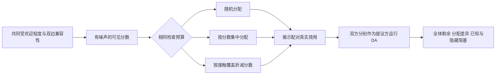

# 从匹配演示到可检验的研究平台

项目现在围绕一个具体问题展开：**当双方是否合适需要通过有限且有成本的接触才能知道时，平台应把接触机会给谁？按预测分数集中推荐，还是适度分散机会？这会怎样改变匹配、福利和稳定性？**

这条主线连接了信息获取、机会拥堵和稳定匹配。新增模块已经实现、运行并验证；原创贡献是否足够支撑论文，仍需要对照最接近的先行研究判断。不能把模型更复杂等同于已经具有学术创新。

## 原项目的问题与本次实质变化

| 原来的限制 | 已完成的加深 |
|---|---|
| 不同机制的名义“约会次数”相同，实际开销不同 | 每种策略在同一个潜在市场检查完全相同数量的不同配对 |
| 单一、对称、独立的效用假设 | 加入共同受欢迎程度、双边兼容性相关、预测噪声、两侧人数不平衡与异质外部选项 |
| 主要看匹配率或已匹配者的平均效用 | 同时报告全体净剩余、双方剩余、接触覆盖率、效用 Gini 和未观测阻塞对 |
| 把完全信息 DA 当作“最优”参照 | 用精确动态规划计算小市场福利上界，明确其可能不稳定 |
| 把数值不动点直接称为均衡 | 重新界定为汇总保留价值闭合，并增加训练／留出事件上的单人偏离诊断 |
| 现实动机主要来自介绍性文字 | 核对官方应用和八项原始研究，实际解析公开接触数据与数据字典 |
| 缺少独立验证和完整复现记录 | 增加数学反例、穷举与暴力核对、配对 bootstrap、参数清单、源码与输出哈希、跨版本 CI |

## 模型的关键机制

平台首先看到带噪声的兼容性分数，选择检查预算内的配对；检查后才知道双方真实效用，最后在已检查且双方都愿意接受的图上运行 DA。



第三种策略是可解释的启发式：已经获得较多接触机会的人，其后续配对优先级被折减。它并不根据见面反馈更新信念，也没有最优性或公平性保证。预算目前约束全市场的配对检查总数，尚不是每个人的日程上限；这一差异在研究设计中明确保留。

共同受欢迎程度会让多人竞争同一个对象，分数噪声又会影响这种集中是否有价值。稳定性引入进一步的重新分配：发现一个更合适的配对，可能让原有匹配链条断开。因此，“获取更多信息”“匹配更多人”和“提高全体福利”不能互相替代。

## 已经得到的理论与实验结果

数学部分给出可检查的命题、证明和两个精确反例。其中一个二乘二市场在增加一条双方都愿意接受的边后，DA 匹配人数从两对降为一对，总效用从 208 降为 10。它反驳的是无条件单调性，不表示随机市场通常会发生同样幅度的下降，也不是声称发现新定理。

主实验使用 8 类情景，每类 100 个独立世界，交叉 4 档预算、3 种策略和 2 个提议方向，保存 19,200 条机制运行记录。世界在处理之间配对复用；这些记录不能当作 19,200 个独立样本。区间按世界重抽样，表达给定模型参数下的蒙特卡洛不确定性。

在基准市场、48 次配对检查、左侧提议的情况下，覆盖策略相比分数贪心的人均净剩余增加 **0.0715**，配对 bootstrap 95% 区间为 **[0.0572, 0.0862]**。但在高受欢迎程度且噪声较大的情景，区间跨过零；右侧稀缺且预算较大时，平均差异还略为负值。项目完整保留这些无显著优势和负向比较。

小市场的 540 条精确参照记录把福利缺口分解为：

$$
S^*_{\mathrm{full}}-S_{\mathrm{DA}}
=\left(S^*_{\mathrm{full}}-S^*_{\mathrm{revealed}}\right)
+\left(S^*_{\mathrm{revealed}}-S_{\mathrm{DA}}\right).
$$

第一项是信息缺失导致的可行福利损失；第二项是选择特定 DA 稳定结果相对已知图福利最优的分配缺口。后者同时包含稳定性约束和稳定结果选择，不能直接解释为纯粹的“稳定性成本”。

原搜索模型的独立诊断没有发现预先给定网格内的盈利偏离。这个零结果被保留；它既没有推翻该闭合，也没有证明 Nash 均衡。

## 现实证据能够支持什么

已核对 FirstDate 官方页面及成本信息获取、匹配拥堵、公平曝光等领域的原始研究。相关机制已有直接先行工作，本项目应先定位为可复现、可反驳的比较平台。

实际解析 Columbia 原始 CSV 后，8,378 条有方向记录去重并排除不可用记录，得到 21 场中的 4,184 对接触，其中 690 对互选，描述性互选率为 **16.49%**。数据字典也已提取核对：评分在见面后填写，第 12 场限制的是接受人数，不是接触次数。原论文只分析其中 14 场，因此本次全样本核查不称作原论文复现。

这些历史场次的场内配对覆盖完整，能检查观测互选图的结构；它们不能直接识别现代推荐平台改变曝光后的政策效果。二元互选也不能识别严格偏好排序、基数效用、长期关系价值或检查成本。原始个体记录没有提交到仓库，只发布汇总与获取方法。

## 下一步怎样形成更强的论文贡献

最值得继续的方向有三个：第一，对有个人接触容量约束的机会分配机制给出可证明的结果或更强的基准；第二，把已揭示反馈用于序贯信念更新，并严格分离训练、调参与独立评价；第三，使用见面前可获得的特征做整场留出预测，继而寻求能够识别曝光政策效果的数据设计。

当前没有完成真实平台福利校准、战略均衡证明、参与者长期动态或前瞻随机试验。完成这些环节需要新的理论或数据证据，而不只是继续增加参数。

## 阅读与复现

- [研究设计与参数](research-design.md)
- [完整结果及负向比较](findings.md)
- [数学证明与反例](theory.md)
- [原模型的十三项审计](model-audit.md)
- [原始文献与现实依据](evidence.md)
- [公开数据核查协议](data-protocol.md)

```bash
python -m pytest -q
python experiments/run_information.py --worlds 100 --small-worlds 30
python experiments/run_threshold_audit.py --events 2000
python experiments/make_research_figures.py
python experiments/validate_research.py
```
