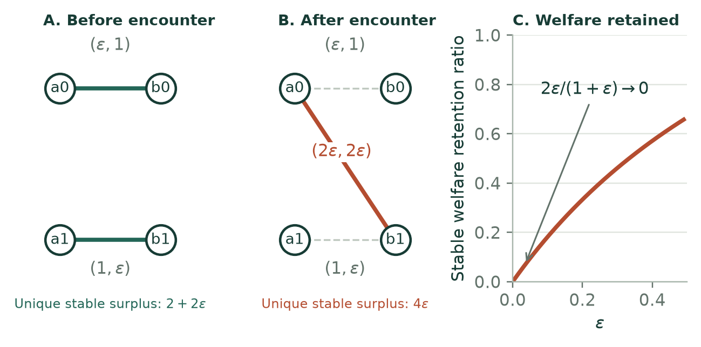

# 新增一次接触，为什么可能让稳定匹配更差？

这篇工作论文围绕一个区别展开：**知道更多配对信息，会扩大可选择的机会；但如果每个新发现的双方互相偏好都必须受到尊重，也会增加稳定性约束。** 同一个旧分配，可能仍然可行，却不再稳定。

英文稿题为 *When learning changes the match: Information, stability, and exposure in finite markets*。它按“问题与文献—模型—命题与证明—计算设计—独立验证—现实证据—局限”组织。以下导读解释核心推导，并区分哪些结论是数学上的可能性，哪些是特定模型中的平均结果。

## 一个两对参与者就能说明的机制

左侧为 $a_0,a_1$，右侧为 $b_0,b_1$。双方未匹配效用均为零。左侧和右侧的效用矩阵分别为

$$
U=\begin{pmatrix}\varepsilon&2\varepsilon\\0&1\end{pmatrix},\qquad
V=\begin{pmatrix}1&0\\2\varepsilon&\varepsilon\end{pmatrix},\qquad 0<\varepsilon<\tfrac12.
$$

$U$ 的行是左侧参与者，$V$ 的行是右侧参与者。最初只有两条对角配对被检查：$(a_0,b_0)$ 和 $(a_1,b_1)$。稳定分配必须保留这两对，总效用为

$$S_{\text{before}}=(\varepsilon+1)+(1+\varepsilon)=2+2\varepsilon.$$

再检查 $(a_0,b_1)$。新的一对互相喜欢对方胜过原伙伴，因此任何稳定匹配都必须让他们在一起。被替换下来的 $a_1,b_0$ 之间没有双方都可接受的配对，最终总效用为

$$S_{\text{after}}=2\varepsilon+2\varepsilon=4\varepsilon.$$

于是

$$\frac{S_{\text{after}}}{S_{\text{before}}}=\frac{2\varepsilon}{1+\varepsilon}\longrightarrow0.$$

这不是靠放大某个效用得到的：所有效用都在 $[0,1]$ 内，而且前后稳定匹配都唯一。取 $\varepsilon=.05$，总效用从 $2.1$ 降到 $.2$。新配对的两个当事人各增加 $.05$，但两名被替换者各失去 $1$。

这里没有否定“可被忽略的信息具有非负价值”。不受稳定性约束的规划者仍可保留原分配。变化来自**新发现的配对可以阻挡旧分配**。这一构造是机制解释，不声称首次发现稳定性与福利的冲突；已有文献研究过严重的稳定性福利损失。

## 为什么必须把三种损失拆开

设 $F$ 为完全信息下可接受的配对图，$E$ 为已经揭示的可接受图。定义：

| 符号 | 含义 |
|---|---|
| $P(F)$ | 全部机会已知时，不要求稳定的最大总剩余 |
| $P(E)$ | 只用已知机会、不要求稳定的最大总剩余 |
| $T(E)$ | 已知机会中，所有稳定匹配的最大总剩余 |
| $D^p(E)$ | 由指定一侧提议的 DA 匹配总剩余 |

因为可行集合逐层收缩，

$$P(F)\ge P(E)\ge T(E)\ge D^p(E).$$

因此得到严格的恒等分解：

$$
P(F)-D^p(E)
=\underbrace{P(F)-P(E)}_{\text{信息缺失}}
+\underbrace{P(E)-T(E)}_{\text{稳定性约束}}
+\underbrace{T(E)-D^p(E)}_{\text{DA 结果选择}}.
$$

三项均非负，但对应的研究问题不同：信息缺失需要更好的发现策略；稳定性损失涉及制度目标之间的取舍；结果选择损失则可能在不放弃稳定性的前提下改善。

本轮实现了精确的“福利最高稳定匹配”求解器。它不把两种提议方向中较好的一个直接当最优：在独立的 500 个完整小市场诊断中，有 **15 个市场的最佳稳定结果严格优于两种 DA 极端结果**。

另一方面，原有 540 条高斯小市场记录的 DA 选择损失都在数值精度内为零。论文保留这个零结果。完整市场诊断是看到零结果后追加的，采用不同效用分布，明确标记为事后诊断，不与主实验混合。

## 更严谨地验证“分散机会是否有用”

此前八情景、19,200 条机制记录属于探索性比较。本轮另生成每情景 500 个新世界，事先固定六个比较，保持策略不调参、双方提议分别评价。每个比较都按完整世界配对重抽样 20,000 次。

对六个主比较使用 Bonferroni 调整：名义边际区间水平为 $1-.05/6=99.1667\%$。这是近似 bootstrap 推断，不是严格有限样本错误率保证，也不包含模型设定不确定性。

| 左侧提议的比较 | 人均净剩余差 | 调整后的名义区间 |
|---|---:|---:|
| 基准市场：覆盖折减减去分数贪心，48 次检查 | +.0742 | [.0658,.0827] |
| 高受欢迎程度且高噪声：同一策略比较 | +.0090 | [.0033,.0147] |
| 基准覆盖策略：192 次减去 96 次检查 | −.0648 | [−.0705,−.0590] |

这里的数字是合成效用单位，不是百分比，也不是现实服务的效果估计。右侧提议的结果相近，全文保留全部六个比较。

尤其需要更新上一轮的解释：高噪声情景原先 100 个世界的区间跨零，新一轮更大的独立样本支持一个**小的正效应**。不能把原来的估计不精确，写成“没有作用”。另一方面，某些其他预算和市场结构仍没有明确优势，不能据此宣称覆盖策略普遍最优。

## 成本增加时，为什么最优检查预算会下降

固定一组候选检查安排 $q$，每种安排具有预期总剩余 $G_q$ 和预期检查次数 $B_q$。检查成本为 $c$ 时，候选集内最优价值为

$$V(c)=\max_q\{G_q-cB_q\}.$$

这是若干下降直线的上包络，因此连续、分段线性、凸且不增。若 $c_1<c_2$ 时最优选择分别为 $(G_1,B_1)$ 和 $(G_2,B_2)$，最优性给出

$$G_1-c_1B_1\ge G_2-c_1B_2,$$
$$G_2-c_2B_2\ge G_1-c_2B_1.$$

相加便有 $(c_2-c_1)(B_1-B_2)\ge0$，所以 $B_1\ge B_2$。这个推导不要求“检查越多，总效用越高”。但它只适用于固定候选集与固定结果分布，并不证明全局最优信息获取策略。

实验证据也采用训练与评价分离：预算先由原有世界选择，再冻结并在新世界评价。因而没有用测试集反过来挑选最有利预算。

## 现实意义与论文贡献的边界

公开 Columbia 接触数据仍承担描述性核查：4,184 对接触、690 对互选，数据字典和实验场次差异均已核对。它不提供未接触双方的偏好，也不能识别可比较的长期效用或现代平台曝光政策的因果效果。原始个体记录不进入发布包。

这篇稿件目前最扎实的价值，是把一个可解释的制度机制、能够区分损失来源的精确基准和可复现的条件性比较组织在一起。命题、数值结果、事后诊断和真实数据描述分别标明。三个相近原始论文的结构模型、十一项研究文献的元数据及版本说明、数值绑定和作者核验状态都随源文件保存。

它仍是工作论文。创新优先权、作者责任、逐项人工文献核验、真实平台校准与投稿适配尚未完成。下一步最有价值的推进是：选择一个明确的制度约束，取得新的理论保证，或获得能够识别真实曝光政策效果的数据；增加参数和样本量本身不能替代这些贡献。

[英文论文](manuscript.pdf) · [数学推导笔记](theory-notes.md) ·
[额外分析协议](validation_protocol.md) · [证据与投稿状态审计](submission_audit.md)
